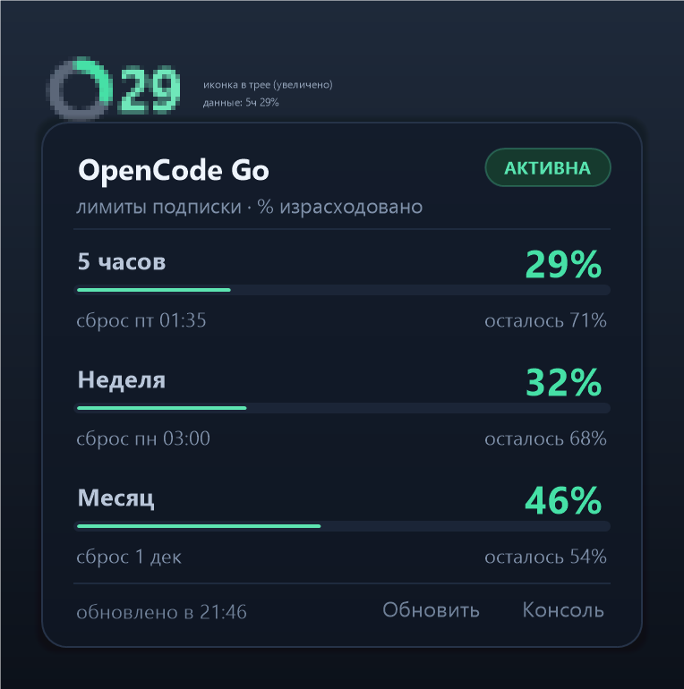
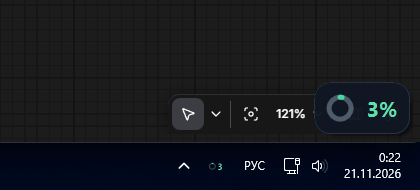
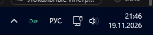

# OpenCode Go Tray

Unofficial Windows tray widget that shows how much of your **OpenCode Go** subscription allowance is used — always visible, one click away from the details.




## Features

- **Tray gauge** — a hollow ring with the 5-hour limit percentage next to it. Color switches from green to amber to red as the limit fills up (60% / 85%).
- **Details popup** — click the icon to see the 5-hour, weekly and monthly limits with progress bars, remaining percentages and reset times.
- **Large badge** (optional) — a floating `96×52` pill near the tray with a big ring and percentage, for when the 16 px tray cell is too small. Draggable, remembers its position, toggled from the context menu.
- **Auto refresh** every 60 seconds; manual refresh from the menu or the popup.
- **Context menu** — refresh, open the OpenCode console, tray icon settings, start with Windows, exit.
- **No dependencies** — a single self-contained executable (~330 KB) compiled against the in-box .NET Framework 4.8; no runtime installs, no background services.

| Popup | Large badge | Tray |
| --- | --- | --- |
|  |  |  |

> The user interface is currently in Russian. Pull requests for localization are welcome.

## How limits are counted

OpenCode Go shares one allowance between all paid models:

| Limit | Share of the monthly allowance | Resets |
| --- | --- | --- |
| 5 hours | 20% | 5 hours after the first request of the window |
| Weekly | 50% | Monday 00:00 UTC |
| Monthly | 100% | Start of the paid period |

The widget shows **used** percentages; the popup also shows what is left. See the [OpenCode Go docs](https://opencode.ai/docs/console/go/#usage-limits) for details.

## Install

### From a release

1. Download `OpenCodeGoTray.exe` from the latest release.
2. Run it — the icon appears in the notification area.
3. Open the context menu and enable **Start with Windows** if you want it to launch automatically.

The executable is unsigned, so SmartScreen may warn you on first launch. Build it yourself if you prefer.

### From source

```powershell
powershell -ExecutionPolicy Bypass -File .\install.ps1
```

`install.ps1` builds the executable, copies it to `%LOCALAPPDATA%\OpenCodeGoTray`, registers autostart, creates a Start Menu shortcut and starts the widget.

### Windows 11 hides new tray icons

New notification area icons land in the `^` overflow menu. Either drag the ring onto the taskbar once, or go to **Settings → Personalization → Taskbar → Other system tray icons** and enable *OpenCode Go Tray*. The same settings page is available from the context menu.

## Usage

- **Left click** the tray icon or the badge — open the details popup.
- **Right click** — context menu (refresh, console, large badge, tray settings, autostart, exit).
- **Drag the badge** to move it anywhere; the position is saved.
- **Esc** or a click outside closes the popup.

## Where the data comes from

The widget calls the endpoint used by the OpenCode client:

```
GET https://opencode.ai/zen/go/v1/usage
Authorization: Bearer <opencode-go API key>
```

The key is read from `%USERPROFILE%\.local\share\opencode\auth.json` (provider `opencode-go`), the same file OpenCode writes after `/connect`. You can override it with the `OPENCODE_GO_KEY` environment variable.

The endpoint is undocumented and may change without notice. The widget degrades gracefully: it keeps the last known values and shows a warning in the popup and tooltip.

This project is **not affiliated with OpenCode / Anomaly**. It is a personal convenience tool.

## Privacy

- The API key never leaves your machine except in requests to `opencode.ai`.
- No telemetry, analytics or third-party services.
- Settings (autostart, badge on/off, badge position) are stored in `HKCU\Software\OpenCodeGoTray`.

## Build

Requirements: Windows 10/11 and PowerShell 5.1+ (the in-box C# compiler is used, no SDK needed).

```powershell
powershell -ExecutionPolicy Bypass -File .\build.ps1
```

Output: `dist\OpenCodeGoTray.exe`.

Useful developer flags:

```powershell
.\dist\OpenCodeGoTray.exe --shot preview.png   # render the popup to PNG
.\dist\OpenCodeGoTray.exe --open               # start and immediately open the popup
```

Regenerate the application icon with `tools\make-icon.ps1` (writes `assets\icon.ico`).

## Uninstall

```powershell
powershell -ExecutionPolicy Bypass -File .\uninstall.ps1
```

Stops the widget, removes the autostart entry, the Start Menu shortcut and `%LOCALAPPDATA%\OpenCodeGoTray`.

## Troubleshooting

| Symptom | Fix |
| --- | --- |
| Popup says the `opencode-go` key is missing | Run `/connect` in OpenCode and choose OpenCode Go |
| `HTTP 401` / `HTTP 403` | The API key was revoked or the subscription ended — reconnect in OpenCode |
| Icon is hidden behind `^` | Drag it onto the taskbar or enable it in the taskbar settings |
| Percentage looks stale | Right click → Refresh; the widget refreshes every 60 seconds |
| Antivirus flags the exe | It is an unsigned single-file build; compile it locally or inspect `src\Program.cs` (single file, ~1.8k lines) |

## Project layout

```
.
├── src/
│   ├── Program.cs        # entire application: tray, popup, badge, usage client
│   └── app.manifest      # DPI awareness and supported OS
├── tools/
│   └── make-icon.ps1     # generates assets/icon.ico
├── assets/
│   └── icon.ico          # application icon
├── screenshots/          # images used by the READMEs
├── build.ps1             # compiles with the in-box csc.exe
├── install.ps1           # build + copy + autostart + shortcut + start
├── uninstall.ps1
└── .github/workflows/    # CI build and release packaging
```

## License

MIT — see [LICENSE](LICENSE).

