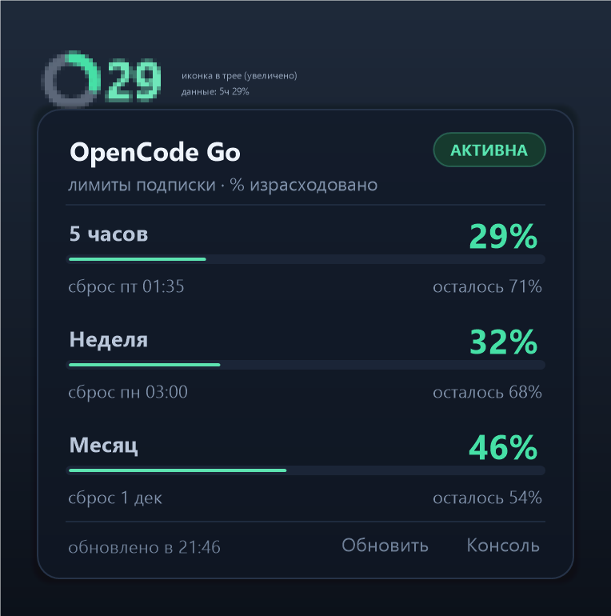
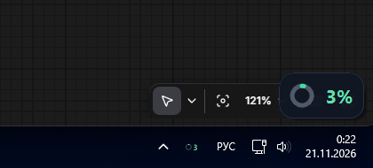
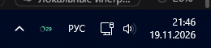

# OpenCode Go Tray

[English](README.md) · **Русский**

Неофициальный виджет для панели задач Windows: показывает, сколько лимита подписки **OpenCode Go** израсходовано.

> **Проект создан не командой OpenCode.** Это независимый неофициальный инструмент: он не создан командой OpenCode, не поддерживается ей и **никак с ней не связан**. Название «OpenCode» использовано только для того, чтобы указать, из какого сервиса виджет берёт данные.




## Возможности

- **Иконка в трее** — пустое кольцо-диаграмма и процент 5-часового лимита рядом. Цвет меняется с зелёного на жёлтый и красный по мере расхода (60% / 85%).
- **Карточка по клику** — 5 часов, неделя, месяц: полосы заполнения, «осталось N%» и время сброса.
- **Крупный индикатор** — плавающая плашка `96×52` у трея с большим кольцом и процентом (ячейка трея в Windows всего 16 px). Перетаскивается, запоминает позицию, включается в меню.
- **Автообновление** раз в 60 секунд, плюс ручное из меню и карточки.
- **Меню правого клика** — обновить, открыть консоль OpenCode, настройки значка, автозапуск, выход.
- **Без зависимостей** — один исполняемый файл (~330 КБ) на встроенном .NET Framework 4.8 и встроенном компиляторе C#.

| Карточка | Крупный индикатор | Трей |
| --- | --- | --- |
|  |  |  |

## Как считаются лимиты

Все платные модели OpenCode Go делят один лимит:

| Лимит | Доля месячного лимита | Сброс |
| --- | --- | --- |
| 5 часов | 20% | через 5 часов после первого запроса окна |
| Неделя | 50% | понедельник 00:00 UTC |
| Месяц | 100% | начало оплаченного периода |

Виджет показывает **израсходованные** проценты, в карточке есть и «осталось». Подробности — в [документации OpenCode Go](https://opencode.ai/docs/console/go/#usage-limits).

## Установка

### Из релиза

1. Скачайте `OpenCodeGoTray.exe` из последнего релиза.
2. Запустите — иконка появится в области уведомлений.
3. В меню правого клика включите **«Запускать при входе»**, если нужен автозапуск.

Файл не подписан, поэтому SmartScreen может предупредить при первом запуске. Можно собрать самостоятельно.

### Из исходников

```powershell
powershell -ExecutionPolicy Bypass -File .\install.ps1
```

Скрипт собирает exe, копирует его в `%LOCALAPPDATA%\OpenCodeGoTray`, включает автозапуск, создаёт ярлык в меню «Пуск» и запускает виджет.

### Windows 11 прячет новые значки в «^»

Перетащите кольцо на панель задач один раз либо включите его в **Параметры → Персонализация → Панель задач → «Другие значки системного трея»**. Этот же раздел открывается из меню виджета.

## Использование

- **Левый клик** по иконке или плашке — карточка с лимитами.
- **Правый клик** — меню.
- **Перетаскивание плашки** — куда угодно, позиция запоминается.
- **Esc** или клик мимо — закрыть карточку.

## Откуда данные

Виджет обращается к тому же эндпоинту, что и клиент OpenCode:

```
GET https://opencode.ai/zen/go/v1/usage
Authorization: Bearer <ключ opencode-go>
```

Ключ берётся из `%USERPROFILE%\.local\share\opencode\auth.json` (провайдер `opencode-go`) — этот файл OpenCode создаёт после `/connect`. Можно переопределить переменной окружения `OPENCODE_GO_KEY`.

Эндпоинт недокументирован и может измениться. Виджет не падает: сохраняет последние значения и показывает предупреждение в карточке и подсказке.

Как указано в начале этого README: виджет создан не командой OpenCode и никак с ней не связан. Это личный инструмент для удобства.

## Приватность

- Ключ не покидает машину, кроме запросов к `opencode.ai`.
- Нет телеметрии и сторонних сервисов.
- Настройки (автозапуск, плашка, её позиция) хранятся в `HKCU\Software\OpenCodeGoTray`.

## Сборка

Нужны Windows 10/11 и PowerShell 5.1+ — используется встроенный компилятор C#, SDK не требуется.

```powershell
powershell -ExecutionPolicy Bypass -File .\build.ps1
```

Результат: `dist\OpenCodeGoTray.exe`.

Флаги для разработки:

```powershell
.\dist\OpenCodeGoTray.exe --shot preview.png   # отрисовать карточку в PNG
.\dist\OpenCodeGoTray.exe --open               # запустить и сразу открыть карточку
```

Иконку приложения можно пересобрать: `tools\make-icon.ps1` → `assets\icon.ico`.

## Удаление

```powershell
powershell -ExecutionPolicy Bypass -File .\uninstall.ps1
```

Останавливает виджет, удаляет автозапуск, ярлык и `%LOCALAPPDATA%\OpenCodeGoTray`.

## Если что-то не работает

| Симптом | Решение |
| --- | --- |
| В карточке «нет ключа opencode-go» | Выполните `/connect` в OpenCode и выберите OpenCode Go |
| `HTTP 401` / `HTTP 403` | Ключ отозван или подписка закончилась — переподключитесь |
| Иконка спрятана за `^` | Перетащите её на панель задач или включите в настройках трея |
| Проценты не обновляются | Правый клик → «Обновить»; автообновление раз в 60 секунд |
| Антивирус ругается на exe | Файл без подписи; соберите локально или посмотрите `src\Program.cs` |

## Структура

```
.
├── src/
│   ├── Program.cs        # всё приложение: трей, карточка, плашка, клиент API
│   └── app.manifest      # DPI-awareness и поддерживаемые ОС
├── tools/
│   └── make-icon.ps1     # генерация assets/icon.ico
├── assets/
│   └── icon.ico
├── screenshots/
├── build.ps1
├── install.ps1
├── uninstall.ps1
└── .github/workflows/    # CI-сборка и релиз
```

## Лицензия

MIT — см. [LICENSE](LICENSE).

